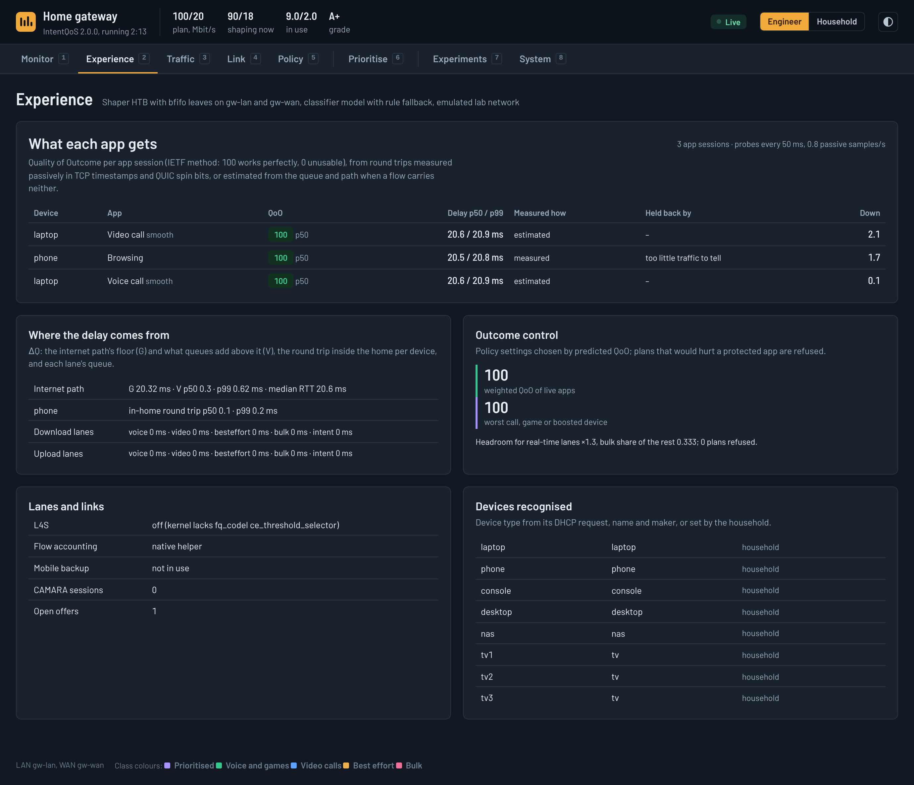
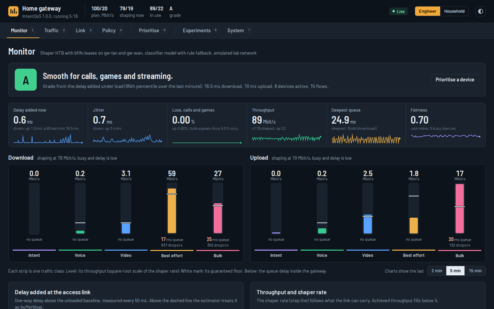
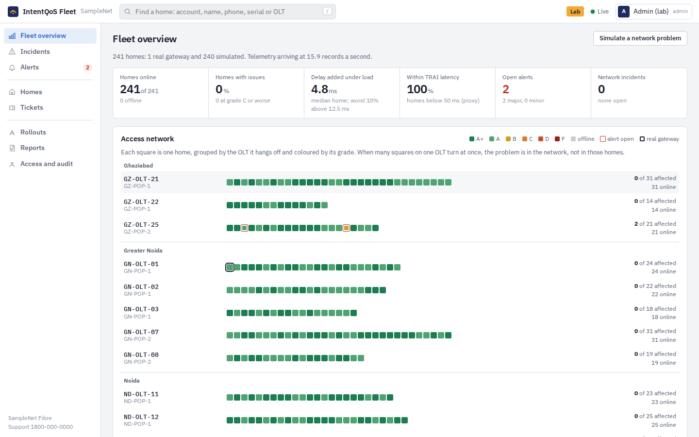
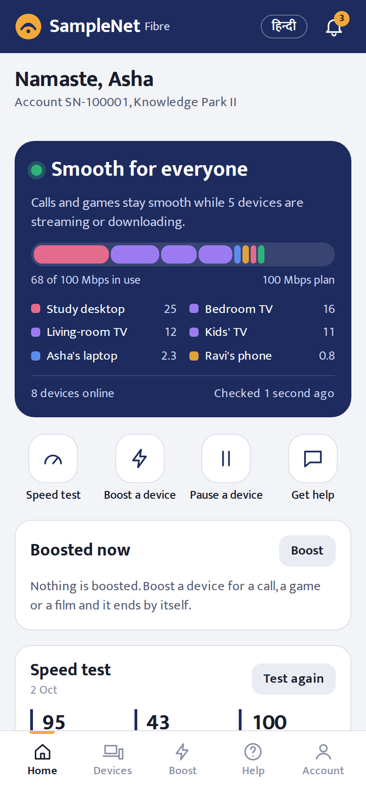

# IntentQoS

**An intent-aware, adaptive QoS engine for mixed home broadband traffic, packaged the way an ISP
would ship it.** Tata Elxsi TELIPORT Season 4, Case Study 3.

IntentQoS runs on the home router. It recognises traffic from packet *sizes and timing only*
(nothing is decrypted, no payload byte is parsed), measures the real capacity of the line from how
delay behaves under load, and reshapes the link every half second so calls and games stay
responsive while downloads and backups keep moving. A person can say "prioritise my work call for
the next hour" and get a time-limited, budgeted lease. Every automated change is bounded, verified,
logged and reversible, and an independent watchdog restores a safe state if the engine fails.

**Reviewing this project? Start with [`docs/JUDGES.md`](docs/JUDGES.md)** (five minutes).

**New in 2.0** ([`docs/INNOVATIONS.md`](docs/INNOVATIONS.md) has what each one does, what was measured, and
what is emulation or simulated):

* The control loop chooses its settings by predicted **Quality of Outcome** of the live apps and refuses plans
  that would hurt a call, a game or a boosted device.
* **Experience sensing from headers**: passive round trips from TCP timestamps (split into internet and
  in-home parts) and QUIC spin bits, ECN and L4S, retransmissions, video frame bursts; per-app QoO and ΔQ.
* An opt-in **kernel flow engine** (eBPF at tc) that keeps the same per-flow statistics without copying
  packets to user space and applies class decisions before netfilter.
* A **whole-home bottleneck locator** (Wi-Fi or the line, per device) and an RFC 8325 Wi-Fi QoS map.
* An **L4S lane**, `cake_mq` and DualPI2 support where the kernel has them.
* A **drift-aware classifier**: per-phase forests by flow age, one-sided adaptive conformal sets, weak labels.
* The **Test Kit** reports QoO, ΔQ, RPM (IETF responsiveness), home-network capacity (RFC 9097 method) and a
  percentile summary next to TRAI's 2024 reference values.
* **CAMARA Quality-on-Demand** at the router and at the operator (the access-network part is simulated),
  proactive boost offers, and requests in plain words (English and some Hindi) confirmed before they apply.
* **Private fleet statistics** (two secret shares, totals only for 5+ homes), TUF-style signed instructions,
  always-valid sequential rollout tests, a TR-181 data model, and ΔQ fault localisation.



| Gateway console (on the router) | Operator console (at the ISP) | Subscriber app (on the phone) |
|---|---|---|
|  |  |  |

More screens in [`docs/img/`](docs/img/): the gateway's Traffic, Link, Policy, Experiments and
Household views; a home, incidents, rollouts and reports in the operator console; devices, boost,
help, account and the Hindi home screen in the app. All taken from the running lab, not mock-ups.

## Run it

| Where | How |
|---|---|
| **Real router and devices** (home kit) | One program per device: `IntentQoS Operator Console.exe` on the operator laptop, `IntentQoS Router Setup.exe` installs onto the GL.iNet/OpenWrt router over SSH, `IntentQoS Test Kit.exe` measures off vs on, `IntentQoS 4G Bridge.exe` for the failover test, the phone scans a QR code. They pair with a PIN and run as one system. [`docs/KIT.md`](docs/KIT.md) (build: `python3 kit/build.py`) |
| **Windows 10/11** (WSL 2) | Double-click `dist/IntentQoS Demo (all three).exe`, or one part: `IntentQoS Gateway.exe`, `IntentQoS Operator Console.exe`, `SampleNet Home App.exe`. `Stop IntentQoS.exe` stops everything. First start installs into WSL in about a minute. [`launcher/README.md`](launcher/README.md) |
| **Linux** (root) | `sudo scripts/stack.sh up`, then http://localhost:8090/ (gateway), http://localhost:8088/ops/ (operator), http://localhost:8088/app/ (subscriber). `sudo scripts/stack.sh down` |
| **Nothing installed** | Open [`docs/console-replay.html`](docs/console-replay.html): the gateway console replaying a recorded session, labelled as a replay |

In the lab the gateway is real (the engine shapes real traffic in an emulated home network) and the
fleet around it is **1 real gateway plus 240 simulated homes** that speak the same signed protocol and
are labelled "simulated" everywhere. Lab sign-in shows role buttons and works only from the same
computer; it is off by default in the code.

## Three parts

| Part | Runs on | Used by | What it does |
|---|---|---|---|
| **Gateway** | the home router (OpenWrt / prplOS, ARM or MIPS) | engineers; households through the app | classification, capacity estimation, shaping with a safety shield, intent leases, watchdog, agent. One 601 KiB `.ipk` (most of it the phase-wise model) plus a 76-142 KB static C capture helper per CPU; pure-Python model runtime. 2.7 % of a core and 25 MB on x86 in the 1.x profile; the 2.0 engine with the experience features measured 2.0 % and 29 MB under the lab's light household load (not the same workload). [`docs/ROUTER_PROFILE.md`](docs/ROUTER_PROFILE.md) |
| **Fleet controller** | the ISP's data centre | network operations, support desk, change management, billing systems | zero-touch enrolment, alerts, OLT incident correlation, "home or network?" diagnosis, remote console, signed config and model rollouts with an always-valid sequential guard, private per-OLT QoO statistics, CAMARA Quality-on-Demand, TRAI-style QoE reports, roles and audit, northbound API and webhooks. [`docs/CONTROLLER.md`](docs/CONTROLLER.md) |
| **Subscriber app** | the subscriber's phone (ISP-branded, English and हिन्दी) | the household | status in plain words, what each device is using, pause, boost, speed test from the router, outage notices, plan and renewal, reports with replies, DPDP privacy controls. [`docs/CONSUMER_APP.md`](docs/CONSUMER_APP.md) |

The router talks to the controller over an outbound-only, signed protocol that maps onto TR-369/USP
([`docs/AGENT_PROTOCOL.md`](docs/AGENT_PROTOCOL.md)). Who uses what and why: [`docs/PRODUCT.md`](docs/PRODUCT.md).
Installing each part for real: [`docs/DEPLOYMENT.md`](docs/DEPLOYMENT.md).
On your own router and devices, without an ISP: the home kit, [`docs/KIT.md`](docs/KIT.md).

| Measured in the lab | Result |
|---|---|
| Zero-touch enrolment → signed config applied on the real engine | works; relay round trip ≈ 0.1 s |
| Speed test from the router across the emulated 100 Mbit/s line | 94–104 Mbit/s, household traffic during the test reported separately |
| OLT congestion (31 simulated homes) | one incident, "30 of 31 homes affected", ~1.5 min after onset |
| Rollout of a regressing model | halted 33 s into stage 1 (23 vs 5.3 ms, p = 8 × 10⁻⁸), 20 homes rolled back automatically |
| Rollout of a good model | 10 % → 50 % → 100 %, real gateway included |

## Results at a glance

> **Two result sets.** The table below is the clean-lab set (`results/`, an emulated 100/20 Mbit/s
> wired line, earlier engine version). The current evidence is the harder, field-calibrated emulation
> of an Indian fibre home in the evening (Wi-Fi stalls, BBR servers, 4G failover, router-class CPU):
> [`results-india_ftth_evening/REPORT.md`](results-india_ftth_evening/REPORT.md), with the method and
> the eight engine faults it exposed in [`docs/FIELD_EMULATION.md`](docs/FIELD_EMULATION.md).
> Headline there (median of 10 runs per arm): upload call delay p99 60.6 → 19.1 ms; download call delay
> p99 after a 4G failover 255 ms (no QoS) → 96 ms; classifier accuracy 99.3 % vs 66.9 % for rules on
> emulated flows. Both sets are emulation, not hardware tests.

| Metric (median of seeds) | No QoS | Static QoS | IntentQoS rules | IntentQoS ML |
|---|---|---|---|---|
| S1 ISO download + backup during a call: call delay p99, upload (ms) | 113 | 19 | 15 | **17** |
| S1: call delay p99, download (ms) | 33 | 48 | 30 | **24** |
| S1: web page load p95 (ms) | 135 | 139 | 142 | **76** |
| S1: ISO download goodput (Mbit/s) | 56 | 81 | 80 | **79** |
| S2 link drops 100 to 20 Mbit/s: call delay p99 once settled (ms) | 219 | 93 | 62 | **47** |
| S2: call quality (MOS) after the drop | 2.24 | 2.76 | 3.97 | **3.90** |
| S2: time until call delay is back within 30 ms (s) | 16 | 15 | 4.3 | **4.9** |
| S2: TV rebuffering (s) | 11 | 13 | 18 | **3.1** |
| S3 three TVs + game + update: game delay p99, download (ms) | 147 | 60 | 27 | **45** |
| S3: mean TV bitrate (Mbit/s) | 11 | 8.5 | 7.4 | **12** |
| S3: game-update download (Mbit/s) | 60 | 58 | 54 | **25** (38 with the bulk-friendly profile) |
| S3: update seconds with no progress (s) | 0.0 | 0.0 | 0.0 | **0.0** |

| S4 two calls on 10/3 Mbit/s | without lease | with lease on the work call |
|---|---|---|
| Work call (laptop) video delay p99, upload (ms) | 34 | **23** |
| Work call (laptop) video loss, upload | 13.6% | **0.0%** |
| Other call (phone) MOS, upload | 4.36 | **4.36** |
| Backup worst 1-second goodput (Mbit/s) | 0.4 | **0.0** |

S5 fault injection: after `kill -9` of the engine the watchdog installed the safe state in **1.8 s** (median of 10 runs, clean-lab set, heartbeat timeout 2 s at the time; the router default is now 8 s after the full-system test showed 2-3 s tripped on a loaded router-class CPU).

**Does the ML help?** Where the class decides the outcome, yes: it recognises adaptive video that
rules lump in with downloads, so TVs rebuffer 3 s instead of 18 s after a link drop and stream at
12 instead of 7.4 Mbit/s in S3, and web pages load in 76 instead of 142 ms during a big download.
Serving streaming above bulk costs the update download (25 vs 54 Mbit/s); that split is an operator
setting, and the bulk-friendly profile measured 38 Mbit/s with TVs still at 10.4 Mbit/s and no
rebuffering. [`docs/FINDINGS.md`](docs/FINDINGS.md) reads every number plainly, including where
IntentQoS does **not** help (the rule arm's lower game delay in S3, the cost of a lease to the other
call).

Full statistics, figures and method: [`results/REPORT.md`](results/REPORT.md)
(also `results/report.html`). Classifier evaluation: [`docs/CLASSIFIER_REPORT.md`](docs/CLASSIFIER_REPORT.md).
**All network conditions are emulated** and labelled as such; see
[`docs/KNOWN_LIMITATIONS.md`](docs/KNOWN_LIMITATIONS.md).

## What is in the box

| Brief asks for | Where |
|---|---|
| Traffic-class and link-capacity estimator | `intentqos/classifier.py`, `features.py`, `estimator.py`, `ml/` |
| Dynamic QoS policy engine and enforcement | `intentqos/policy.py` (with safety shield), `enforce.py` (CAKE or HTB + nftables), `daemon.py` |
| Dashboard: latency, jitter, loss, throughput, queue depth, fairness | Console **Monitor** view (`intentqos/web/console.html`), `GET /metrics` (Prometheus) |
| Automated baseline-vs-optimised experiments | `testbed/run_eval.py`, `scenarios.py`, `report.py`; run from the console's **Experiments** view via `testbed/labd.py` |
| API / UI for temporary service intent | `intentqos/intents.py` (leases), `console.py` (modes, schedules), `api.py` (`POST /api/intents`), console **Prioritise** view |
| Architecture diagram | [`docs/ARCHITECTURE.md`](docs/ARCHITECTURE.md); live version in the console's **System** view |
| Setup guide with versions, commands, verification | [`docs/SETUP.md`](docs/SETUP.md); verification steps run live in **System → Setup check** (`GET /api/setup-check`) |
| Scripted demo that resets, injects, collects, reports | `scripts/demo.py`, `make eval report` |
| Per-module inputs, outputs, states, failures, success | [`docs/MODULES.md`](docs/MODULES.md) |
| Known limitations vs. production | [`docs/KNOWN_LIMITATIONS.md`](docs/KNOWN_LIMITATIONS.md) |
| Third-party licences | [`THIRD_PARTY_LICENSES.md`](THIRD_PARTY_LICENSES.md) |

## Quick start (emulated home network, one Linux machine)

```bash
sudo make lab              # testbed + engine + watchdog + lab server; console at http://localhost:8090/
make test                  # unit tests (121), no root needed
pip install -r requirements.txt   # only to retrain the model or rebuild the report figures
```

The lab server brings up the emulated home network (clients, gateway, a bloated 100/20 Mbit/s
ISP modem, a server), starts the engine and watchdog in the gateway, and serves the console with
lab controls: start a video call, an ISO download, a backup, three TVs or a game; drop the link
to 20/5 Mbit/s; crash the engine; run a scenario against the baselines.

Without the lab server:

```bash
sudo make testbed          # the emulated home network only
sudo make engine           # IntentQoS in the gateway; console at http://10.255.0.2:8080/
sudo make demo             # second terminal: 80-second scripted story
```

Reproduce every number in the report: `sudo make dataset train eval report` (about 3 hours).
Deploy on a real router: [`docs/SETUP.md`](docs/SETUP.md#b-real-gateway).

## How it works

```
 every 250 ms:  tc counters ─► capacity estimator (delay rise per direction) ─► shaper rate
 every 500 ms:  headers ─► flow table ─► classifier (user fix > ML if confident > rules)
                intent leases (expire, budget, bargain) ─┐
                                                         ▼
                policy: floors + intent grants + realtime reservation ─► SHIELD ─► tc/nft (verify, else roll back)
 always:        watchdog: stale heartbeat ─► known-safe state
```

- **Classification without payload.** 27 statistics of packet sizes, inter-arrival times,
  direction and burst structure. Ports and addresses are not used. A random forest with
  isotonic calibration gives a real probability; split-conformal prediction gives a set of
  labels with a 90 % coverage guarantee, and when that set has more than one label the
  model abstains and the deterministic rule baseline decides. One click in the console
  corrects a label at once and stores the example for retraining; a Page-Hinkley detector
  flags drift.
- **Capacity from delay, not speed tests.** ICMP timestamp probes give one-way delay up and
  down separately. When the *minimum* delay over 400 ms rises 15 ms above the unloaded
  baseline under load (a standing queue, not a spike), the shaper is cut below what the link
  just delivered; when loaded and healthy it probes up in small steps. Re-implemented from
  the published design of cake-autorate.
- **Policy that cannot starve anyone.** Floors first (bulk 5 %, best effort 10 %, voice and
  video 5 % each), then intent grants, then measured realtime demand × 1.3 (capped at 60 %),
  then the rest to best effort and bulk (2:1 by default; `policy.remainder_bulk_share` is an operator
  setting pushed per home). A shield enforces rate bounds, step limits and a
  change budget; a starved class triggers rollback.
- **Intents as leases.** Expiry (≤ 8 h), a per-person daily budget, admission control
  (≤ 60 % of the link for all leases), conflicts resolved by weighted Nash bargaining, and a
  live assurance check ("Working", "Not meeting its goal", "Link too slow for this").
- **Enforcement you can inspect.** CAKE (`diffserv4`, per-host isolation) on stock kernels,
  HTB with floors otherwise; nftables verdict maps with timeouts map each flow to a class
  and a DSCP code point (so Wi-Fi WMM honours it). Every change is applied, read back and
  committed, or rolled back.

## Repository layout

```
intentqos/        the engine (capture, features, classifier, treemodel, estimator, policy, enforce,
                  intents, manage, metrics, console services, api, daemon, watchdog, agent, ed25519,
                  uciconf, web/console.html)
router/           iq-capture.c, static binaries (router/bin), OpenWrt package and init script,
                  build_ipk.py, packages (router/dist), container image for prplOS LCM
controller/       fleet controller: core, server, db, security, pki, seed, simfleet, web/ops.html,
                  web/app.html (consumer app)
testbed/          namespace testbed, traffic generators, delay line, scenarios, evaluation, report,
                  labd.py (the console's lab server)
scripts/          stack.sh (whole system, or one part), demo, replay recorder and builder, figure rendering
launcher/         Windows launchers (Go): build.py, wsl-setup.sh; built exes go to dist/
ml/               dataset recorder and generator, trainer (calibration + conformal)
models/           trained model bundle + its evaluation report
config/           testbed.toml (includes the lab agent), example-router.toml
deploy/           systemd units (hardened)
docs/             JUDGES.md (start here), product, router profile, agent protocol, controller, consumer app, deployment,
                  architecture, modules, setup, limitations, demo runbook, classifier report,
                  UX brief, console-replay.html
results/          clean-lab set: REPORT.md, report.html, figures, summary.json (raw runs: regenerate with testbed.run_eval)
results-india_ftth_evening/  field-calibrated set: REPORT.md, report.html, figures, classifier accuracy
tests/            unit tests (CI: .github/workflows/ci.yml)
```

Licence: MIT. Three OFL-licensed typefaces are bundled (subset); see [`THIRD_PARTY_LICENSES.md`](THIRD_PARTY_LICENSES.md).

## Full-system emulation (Nov 2026)

The whole Round 2 setup was run in emulation against the real OpenWrt 25.12.6 image: Router Setup installing over
SSH with real packages, the Operator Console, Test Kit, 4G Bridge and phone app driven through their windows, a
household of eight devices on emulated fibre, Wi-Fi and 4G, and fibre-to-4G failover, power cuts and console
outages. It found and fixed eight real problems (an engine crash on real firmware among them). Report, charts,
screenshots and evidence: [results-systemsim/REPORT.md](results-systemsim/REPORT.md); harness: [systemsim/](systemsim/README.md).
