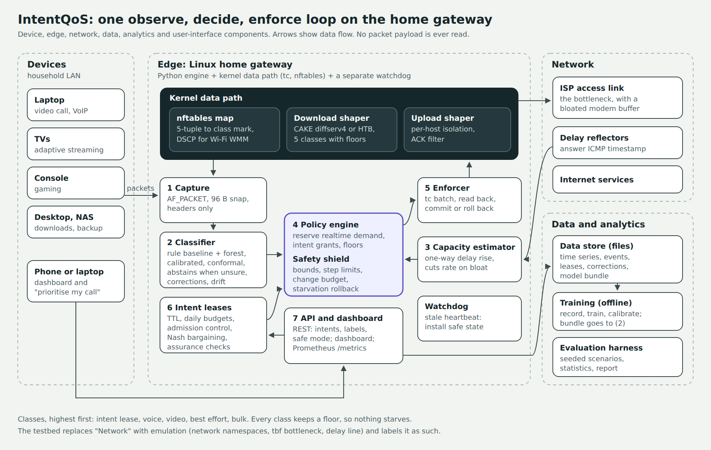
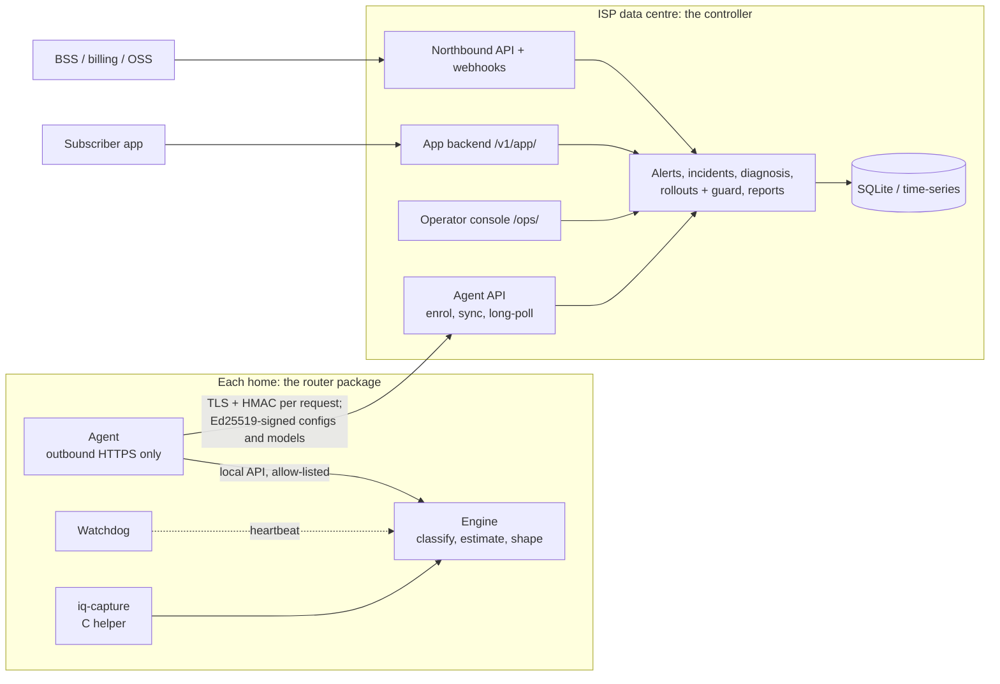
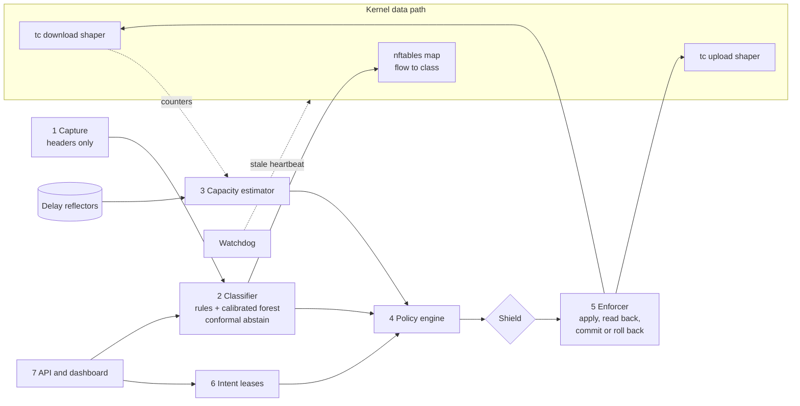

# Architecture



## System: three tiers



| Tier | Process | Trust boundary |
|---|---|---|
| Router | engine (root caps: `CAP_NET_ADMIN`, `CAP_NET_RAW`), watchdog, agent, capture helper | The local console and API need the router key (printed on the label, 0600 on disk); the agent can only call an allow-list of local API routes and verifies the operator's signature on every config and model before applying it |
| Controller | one Python service (HTTPS), housekeeping thread every 15 s | Staff sign in with roles (viewer, support, noc, admin), locked out after 5 failures in 15 min; subscribers with phone + OTP; BSS with an API key. Every access to a home is audited and visible to that subscriber |
| App | a web app served by the controller | Sees only its own home; live actions are relayed to the router, not stored |

Details: [AGENT_PROTOCOL.md](AGENT_PROTOCOL.md), [CONTROLLER.md](CONTROLLER.md),
[CONSUMER_APP.md](CONSUMER_APP.md), [ROUTER_PROFILE.md](ROUTER_PROFILE.md).

### The lab: all three tiers on one laptop

```
Windows                         WSL 2 (Ubuntu), /opt/intentqos
  launcher .exe ──wsl.exe──►   scripts/stack.sh up <part>
  (Go, embeds the release)       ├─ controller   :8443 HTTPS (agents)   :8088 HTTP, 127.0.0.1 only (consoles)
                                 ├─ simfleet     240 simulated homes, same signed protocol
  Edge --app windows ◄────────── ├─ testbed      network namespaces: 8 devices, gateway, 100/20 Mbit/s modem, server
    :8090  gateway console       ├─ engine, watchdog, agent   in the gateway namespace (real tc + nftables)
    :8088  /ops/ and /app/       └─ labd          :8090 console + lab controls (traffic presets, link, faults)
```

The launchers only install and start; every process is the same code that would run on a router
or in a data centre. On Linux, `sudo scripts/stack.sh up` does the same without Windows.

## The engine on the gateway

The engine is a single control loop on the home gateway. Every 250 ms it reads the
shaper's own counters and the delay probes; every 500 ms it also re-classifies flows
and re-runs the intent leases. Whatever it decides passes through a safety shield
before it reaches the kernel, and a separate watchdog process can always put the
gateway back into a known-safe state. It works the same with or without a controller.

## Components by layer

| Layer | Component | Where |
|---|---|---|
| Device | Household devices generate traffic; any phone/laptop opens the dashboard and declares intents | LAN |
| Edge | (1) capture, (2) classifier, (3) capacity estimator, (4) policy engine + shield, (5) enforcer, (6) intent leases, (7) API/dashboard, watchdog | `intentqos/` on the Linux gateway |
| Edge, kernel | nftables verdict maps (flow → class mark → priority + DSCP), `tc` shaper on LAN egress (download) and WAN egress (upload): CAKE or HTB | kernel |
| Network | ISP access link (the bottleneck), delay reflectors (ICMP timestamp), internet services | outside the home |
| Data | per-tick time series (JSONL), event log, intent leases, user corrections and overrides, model (`.iqm`); volatile data in RAM (`/tmp`), small state in `/etc/intentqos` | `data/`, `models/` |
| Fleet | agent → controller: telemetry, events, command results; controller → agent: signed configs, models, relayed console calls | `intentqos/agent.py`, `controller/` |
| Analytics | dataset recorder, trainer (calibration + conformal threshold), evaluation harness, report generator | `ml/`, `testbed/` |
| User interface | engine console, REST API, Prometheus `/metrics`; operator console and consumer app on the controller | `intentqos/api.py`, `intentqos/web/`, `controller/web/` |

## One tick, step by step



1. **Read counters** (`tc -j -s`): achieved throughput per direction, per-class bytes, backlog, drops.
2. **Estimate capacity**: delay rise above baseline per direction → shaper rate.
3. **Every 500 ms**: close the flow windows, classify (user correction → ML if confident → rules),
   run leases (activate, expire, re-bargain), map flows to classes, sync nftables marks.
4. **Decide** guarantees per class; **shield** them; apply only if the change is ≥ 5 %.
5. **Check health**: a class with backlog and no service for 3 s triggers a rollback.
6. **Publish**: heartbeat (for the watchdog), history, dashboard snapshot, Prometheus.

## Why these choices

| Decision | Alternative considered | Why |
|---|---|---|
| Shape below the bottleneck with CAKE/HTB and keep the queue at home | Ask the ISP for priority (DSCP upstream) | Most ISPs bleach DSCP; only the home side is controllable |
| Latency-driven capacity estimate (delay rise under load) | Periodic speed tests | Speed tests add load, are slow, and AQM distorts them (arXiv 2511.19213) |
| ICMP *timestamp* probes | RTT-only ping | Separates upload from download bloat; with RTT only a congested upload wrongly throttles download |
| Header-only statistical features | DPI / TLS SNI | The brief forbids payload inspection; it also keeps the system honest under encryption |
| Random forest + isotonic calibration + split conformal | Deep model | Small, fast (ms per batch), explainable, and the conformal set gives a coverage guarantee and a principled "abstain" |
| ML only in classification; deterministic, shielded policy | RL policy | The brief asks for bounded, reversible remediation; a shielded controller is provably within its envelope |
| Leases with budgets and bargaining | A "priority" toggle | A toggle is permanent unless someone remembers to turn it off, and two toggles conflict silently |
| Separate watchdog process | Try/except inside the engine | A crashed or hung engine cannot fix itself |
| stdlib HTTP server, TOML config | FastAPI, YAML | Fewer dependencies on a router; rule mode needs nothing beyond the Python standard library |
