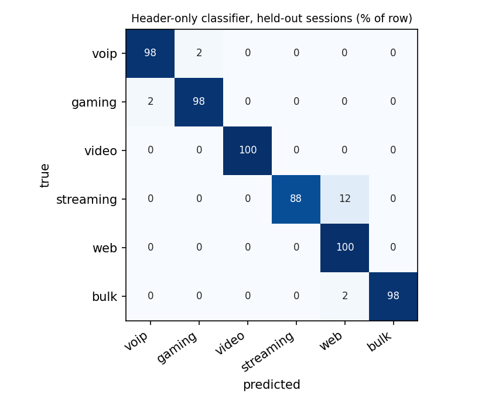

# Classifier report (auto-generated by `ml/train.py`)

Trained 2026-10-01 14:29:54 on `ml/data/dataset.jsonl`: 9314 train / 2375 calibration / 3994 test snapshots, split **by session** (14/4/6).

Model: RandomForest(60 trees, depth 14) + isotonic calibration (3-fold). Features: 27 header-only statistics (sizes, timing, direction, protocol). **Payload bytes used: 0.** Ports and addresses are not features.

## Held-out results

| | macro-F1 (label) | accuracy (label) | accuracy (scheduling class) |
|---|---|---|---|
| Rule baseline (qosify-style) | 0.439 | 0.524 | 0.703 |
| ML (argmax) | 0.966 | 0.973 | 0.993 |
| **Hybrid: ML when confident, rules when abstaining** | **0.945** | **0.954** | **0.987** |

Conformal prediction (target coverage 90%): empirical coverage 0.945, abstain rate 0.044, accuracy when not abstaining 0.9877.

Calibration (expected calibration error): raw RF 0.052 -> isotonic 0.007.

Inference: 15.13 ms per batch of 32 flows.

## Time to the right scheduling class (per flow, held-out)

| class | flows | rules: median s to correct | rules: share of lifetime correct | hybrid: median s | hybrid: share correct |
|---|---|---|---|---|---|
| voip | 7 | 0.22 | 1.000 | 0.22 | 1.000 |
| gaming | 8 | 0.22 | 0.943 | 0.22 | 1.000 |
| video | 6 | 0.39 | 1.000 | 0.39 | 1.000 |
| streaming | 7 | 0.35 | 0.398 | 0.35 | 0.993 |
| web | 6 | 0.37 | 0.976 | 0.37 | 1.000 |
| bulk | 28 | 6.31 | 0.505 | 0.46 | 0.972 |
| **all flows** | 62 | 0.48 | 0.699 | 0.35 | 0.987 |

## Most important features

- `early_mean` (0.183)
- `early_max` (0.104)
- `early_iat_ms` (0.074)
- `is_udp` (0.055)
- `log_bytes` (0.054)
- `std_up` (0.045)
- `early_up_frac` (0.036)
- `small_frac` (0.035)
- `dn_up_ratio` (0.035)
- `mean_up` (0.033)

> Caveat: trained and tested on emulated traffic from `testbed/traffic.py` with randomised parameters. Accuracy on real household traffic will differ; record consented real traces with `ml/record.py` and use dashboard corrections (`data/corrections.jsonl`) to retrain.
