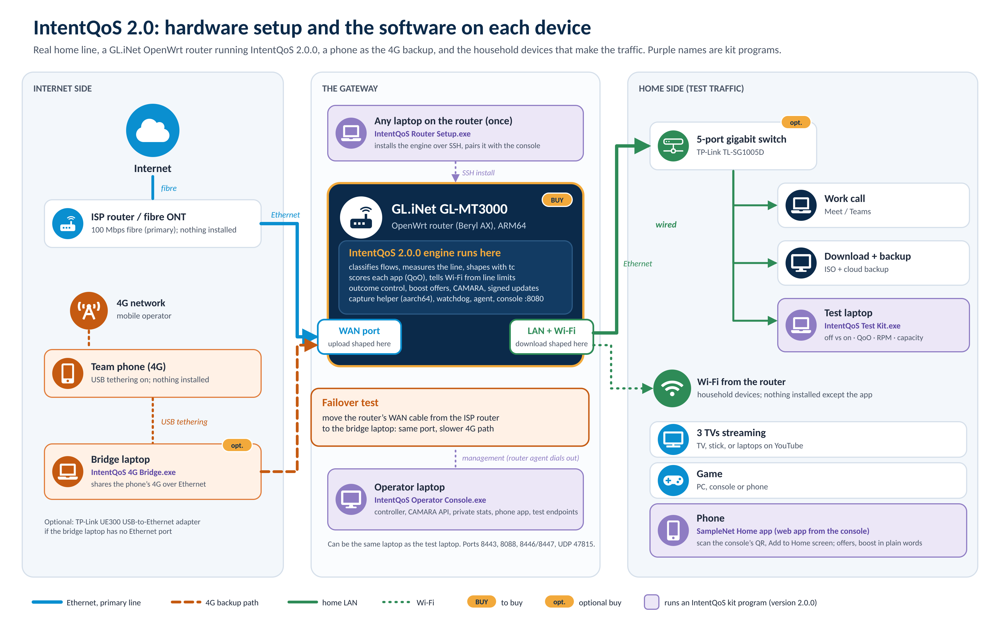

# The IntentQoS home kit: one program per device

The kit runs IntentQoS for real: on a real router, on a real home line, with the phone and laptops of a real
household. Each device gets its own double-click program. The programs find each other on the home network
and pair with a 6-digit PIN, so together they work as one system.



| Device | Program (Windows file name) | What it does |
|---|---|---|
| **Router** (GL.iNet GL-MT3000 or any OpenWrt router) | nothing to copy: **IntentQoS Router Setup** installs it from any laptop | the IntentQoS engine, watchdog and agent; the router console on `http://<router>:8080/` |
| **Operator laptop** | `IntentQoS Operator Console.exe` | the fleet controller, the operator console, the phone-app server and the kit's pairing service. It carries its own Python, so nothing needs installing. |
| **Any laptop on the router** (once) | `IntentQoS Router Setup.exe` | finds the router, installs IntentQoS over SSH, detects its ports, pairs it with the console. Also updates and uninstalls. |
| **Test laptop** | `IntentQoS Test Kit.exe` | runs each test with IntentQoS off and then on, guides the fibre → 4G failover test, writes the report and sends it to the console |
| **Bridge laptop** | `IntentQoS 4G Bridge.exe` | shares a phone's USB-tethered 4G over the Ethernet port, so the router's WAN cable can be moved to 4G |
| **Phone** | nothing to install: scan the QR code on the console, then **Add to Home screen** | the SampleNet Home app: status, devices, pause, boost a work call, speed test |

Linux builds have the same programs (`intentqos-console`, `intentqos-router-setup`, `intentqos-testkit`,
`intentqos-4g-bridge`). macOS has Router Setup and Test Kit; its Operator Console needs Python 3.11 or newer
installed from python.org. One laptop can run several programs: the operator laptop can also be the test laptop.

## Before you start

* **Router.** A GL.iNet GL-MT3000, or any router running OpenWrt 21.02 or newer (24.10 and 25.12 tested, both
  opkg and apk firmware), with SSH on and its own internet connection. The installer downloads Python, `tc`
  and nftables from the router's package feed (about 20 MB of flash). For GL.iNet firmware, the SSH password is
  the admin-panel password. Hardware acceleration ("Network Acceleration" in the GL.iNet panel) must be off,
  or packets skip the shaper. The installer turns off OpenWrt's flow offloading and the router's own QoS, and
  puts both back when you uninstall.
* **Laptops.** Windows 10 or 11 (or Linux). The programs are not code-signed, so the first time Windows may say
  "Windows protected your PC": choose **More info → Run anyway**.
* **Network.** The operator laptop, the test laptop and the phone join the router's Wi-Fi or LAN. The 4G Bridge
  laptop is only connected to the phone (USB) and, during the failover test, to the router's WAN port.

## Step by step

1. **Operator laptop → `IntentQoS Operator Console.exe`.** The first start takes about half a minute. Windows
   asks once whether the console may let routers and phones reach it; choose **Yes**, and allow Python on
   private networks if Windows asks. The window shows the **pairing PIN**, the phone QR code and a setup
   checklist. Keep the window open, because closing it stops the console.
2. **Any laptop on the router → `IntentQoS Router Setup.exe`.**
   1. It finds the router.
   2. Sign in with the router password.
   3. Enter your plan speeds, for example 100/100.
   4. Type the PIN.
   5. Press **Install**.

   After a few minutes it shows the router console address and the **router key**. The router then connects
   to the Operator Console by itself, and the checklist turns green.
3. **Phone.** Join the router's Wi-Fi and scan the QR code on the console. Sign in with the household number
   shown there; the one-time code appears on the phone, because there is no SMS gateway in the kit. Then use
   the browser menu: **Add to Home screen**.
4. **Test laptop → `IntentQoS Test Kit.exe`.** It uses the router saved by Router Setup, or you pair it with the
   PIN, or you type the router address and key. Choose the tests and press **Run tests**. Each test runs
   twice, first with IntentQoS off and then on. The report opens from the window, is saved in
   *Documents › IntentQoS Reports*, and appears under **Test reports** on the console.
5. **Failover test.**
   1. Plug the phone into the bridge laptop and turn on USB tethering.
   2. Start `IntentQoS 4G Bridge.exe` and press **Share the phone's 4G**.
   3. In the Test Kit, choose **Failover test**.
   4. When it asks, move the router's WAN cable from the ISP router to the bridge laptop, and press
      **Cable moved**.

## How the pieces talk

```
                 UDP 47815 "where is the console?" (broadcast on the home network)
   Router Setup ─┐  HTTPS 8443  /v1/kit/pair (PIN)            ┌─ phone: HTTP 8088 /app/ and /v1/app/*
   Test Kit ─────┼────────────────────────────▶  Operator Console (controller) ◀──────────────────────
                 │                                     ▲  HTTPS 8443 /v1/agent/* (outbound from the router,
   Router Setup ──── SSH 22 (install) ──▶ Router ──────┘  signed requests, operator CA, Ed25519-signed configs)
   Test Kit ──────── HTTP 8080 /api/state, /api/bypass (router key) ──▶ Router
   Test Kit ──────── HTTPS 8446 RPM endpoints, UDP 8447 capacity ──▶ Operator Console (home-network test)
```

* **Pairing.**
  * A program finds the console by broadcast, or by an address you type, and sends the PIN.
  * The console answers with its certificate authority, its release key and a one-time claim code. The
    router's agent then enrols over the same signed protocol an ISP fleet uses
    ([AGENT_PROTOCOL.md](AGENT_PROTOCOL.md)).
  * Five wrong PINs lock pairing for five minutes. A new PIN is made on every start.
* **Moving laptops.** The console issues itself a new certificate for its current addresses on every start.
  If the laptop gets a new address, the router asks the home network where the console is and switches to the
  new address. It switches only after that address proves, over TLS with the console's own CA, that it is the
  same console.
* **The no-QoS test window.** `POST /api/bypass` removes all shaping and flow marks for at most 30 minutes and
  restores them by itself, so a test can never leave the router unshaped. The Test Kit uses it for the "off"
  half of every comparison.
* **Home-network test.** The Operator Console also serves measurement endpoints on the home network
  (`kit/lab.go`): RPM endpoints over HTTPS with HTTP/2 on port 8446 (`/.well-known/nq`, a 1-byte object, an
  8 GB stream, an upload sink) and a UDP capacity sink on port 8447. Its certificate is made at start-up and its
  SHA-256 fingerprint is published in the console's discovery answer; the Test Kit accepts that certificate and
  no other. The capacity test follows the RFC 9097 method (rate raised from 50 ms receiver feedback while there
  is no loss and the delay range stays under 30 ms, lowered on loss or a range over 90 ms; result = the highest
  1-second rate). Its messages are IntentQoS's own, not the RFC 9946 (UDPST) protocol.
* **What the phone gets.** In kit mode the console serves the app to the home network on plain HTTP, the way a
  router serves its own admin page. Every other page (the operator console, the kit page, pairing status) is
  available only on the console laptop itself.

## Files and settings

| Where | What |
|---|---|
| `%LOCALAPPDATA%\IntentQoS\console\` | the console's database, certificates and keys (`data\`), its unpacked Python and code |
| `%LOCALAPPDATA%\IntentQoS\kit.json` | what programs on this laptop share: the paired console and its CA, known routers and keys, router SSH host keys |
| `%LOCALAPPDATA%\IntentQoS\logs\` | one log per program, plus `controller.log` |
| `Documents\IntentQoS Reports\` | Test Kit reports (HTML and JSON) |
| router: `/etc/config/intentqos`, `/etc/intentqos/` | settings, router key (`admin.key`), agent enrolment, saved router settings for uninstall |

Linux uses `~/.local/share/intentqos/` instead of `%LOCALAPPDATA%\IntentQoS\`.

**Uninstall.**
* Router: Router Setup → **Uninstall from this router**, or on the router run
  `sh /usr/lib/intentqos/uninstall.sh [--purge]`.
* Laptops: delete the programs and the `IntentQoS` folder.
* Windows firewall: remove the rules `IntentQoS-Operator-Console`, `IntentQoS-Operator-Console-Discovery`,
  `IntentQoS-Operator-Console-Lab` and `IntentQoS-Operator-Console-LabUDP`.
* The router installer also sets the Wi-Fi QoS map (`iw_qos_map_set`, see below); uninstall puts the old value
  back. Pass `--no-qos-map` to the installer to leave Wi-Fi alone.

## What the Test Kit reports

Each comparison (IntentQoS off, then on) now carries, besides delay percentiles and throughput:

* **Quality of Outcome** for a video call, a voice call, an online game and web browsing (IETF
  draft-ietf-ippm-qoo; the same requirement values the router uses), and which measure limits each.
* **ΔQ split**: the floor G (lowest round trip) and the queueing V above it at p50 and p99; jitter as the mean
  and 90th percentile change between consecutive round trips.
* **A percentile summary next to TRAI's 2024 wireline reference values** (latency under 50 ms, jitter under
  40 ms, as reported by MediaNama). TRAI measures the operator's network; this test runs through the home
  network and the router, so it is a reference, not a compliance test.
* **RPM** (draft-ietf-ippm-responsiveness-09: foreign probes on new connections, loaded probes on the load
  connections, 95 % trimmed means). In the ordinary scenarios the probes ride on the scenario's own load. Two
  new scenarios: **Responsiveness (RPM)** runs the draft's procedure (load connections added every 5 s up to
  16 until goodput is stable, then responsiveness over the last four intervals, with the draft's Low / Medium /
  High confidence), and **Home network only** measures capacity and RPM between the laptop and the Operator
  Console without the internet.

## When something does not work

| Symptom | Likely cause and fix |
|---|---|
| Router Setup finds no router | type the address printed on the router's label (GL.iNet `192.168.8.1`, OpenWrt `192.168.1.1`) |
| "did not accept that password" | GL.iNet: admin-panel password; OpenWrt: the root password from LuCI (empty if never set) |
| "the router has no internet connection" | connect the router's WAN first; the installer downloads packages from the router's feed |
| Router paired but the console shows it waiting | the console window must be open; check the firewall prompt was allowed (Windows Firewall, rule `IntentQoS-Operator-Console`) |
| Phone cannot open the app | phone must be on the router's Wi-Fi (not mobile data); use the address under the QR code |
| Test shows no difference | turn off GL.iNet Network Acceleration; check the plan speeds in Router Setup; run while the home is otherwise quiet |
| 4G Bridge: "phone not found" | a different USB cable (some charge only), USB tethering on, unlock the phone |
| "Home network only" says the console has no test endpoints | update the Operator Console; allow its firewall prompt (rules `…-Lab`, `…-LabUDP`) |

## What was tested, and how

* **Router side.**
  * The router package was installed by Router Setup into the real OpenWrt 25.12.6 userland (procd, netifd,
    fw4, dropbear, apk), booted as a virtual router in a network namespace.
  * Tested: install, auto-detection of LAN and WAN, pairing, enrolment, the router console, the phone-app
    relay, uninstall and reinstall.
  * The dependency install was also tested on OpenWrt 24.10.4 (opkg). The engine imports cleanly on Python 3.9,
    the version on GL.iNet's OpenWrt 21.02-based firmware.
  * Not yet tested on a physical GL-MT3000.
* **Operator Console.** The Linux build was run in full: it unpacks its own Python, creates the certificates and
  database, and serves the kit. The Windows build is compiled from the same code and checked statically, but was
  not run here (no Windows machine available).
* **Test Kit.** Run through the virtual router over an emulated 50/20 Mbit/s line with oversized ISP buffers:
  * work call while a backup uploads: delay p99 81 → 13 ms
  * game while downloads run: 59 → 33 ms
  * everyone online: 87 → 14 ms

  These are emulation numbers, like everything else in this project until the hardware trial.
* **Test Kit additions (2.0).** QoO, ΔQ, the report and the home-network endpoints have Go tests
  (`go test -tags testkit ./kit`); the capacity test and the RPM procedure ran end to end on loopback against
  the console's lab endpoints, including refusal of a wrong certificate. Not yet run on a real line or Wi-Fi.
* **4G Bridge.** Windows Internet Connection Sharing and Linux NetworkManager sharing are written to their
  documented interfaces but could not be exercised here.

## Building

```
python3 kit/build.py            # dist/kit/{windows,linux,macos,router}; needs Go 1.24+ and Pillow
```

The build packs the router payload (`router/build_payload.py`), the controller code, and a trimmed portable
Python (python-build-standalone 3.12, downloaded once into `kit/.cache`) into the Operator Console. It then
cross-compiles the four programs, from one Go code base in `kit/`, with build tags `console`, `router`,
`testkit` and `bridge`. Every program also has a command-line mode for scripting (run it with `--help`).
