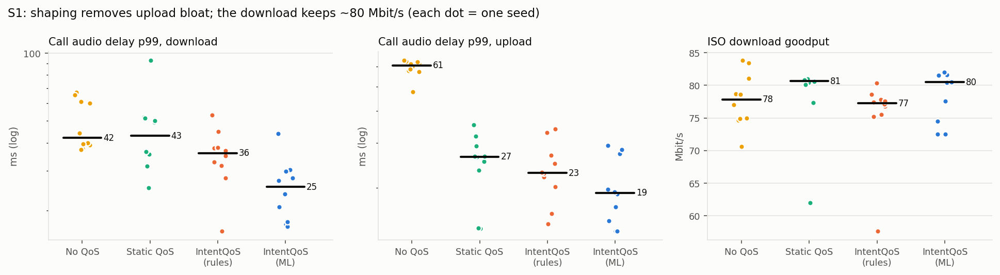
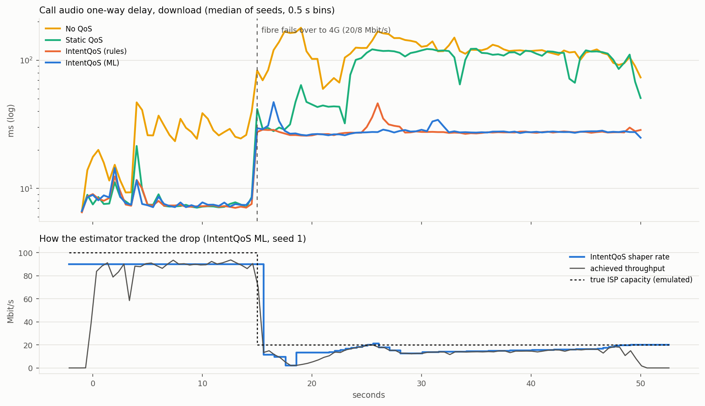
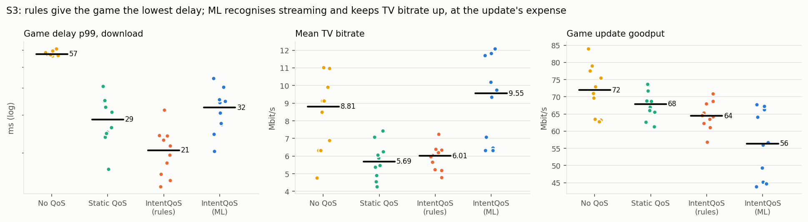
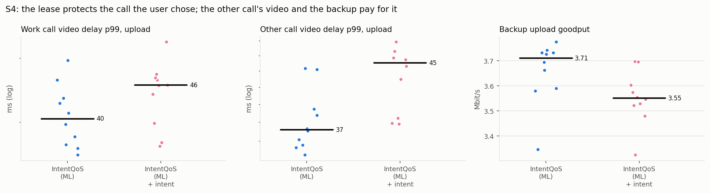
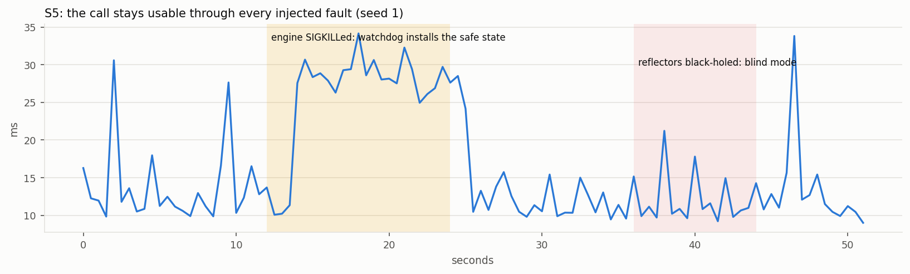

# IntentQoS evaluation report

Generated 2026-10-15 17:01 from `results-india_ftth_evening/runs/`. **Field-calibrated profile `india_ftth_evening`** (Urban Indian home on fibre (FTTH/GPON), evening, devices on Wi-Fi): 100/100 Mbit/s plan, ISP buffer 50 ms, evening capacity dips, home Wi-Fi per device, line drop = failover to a 4G backup, servers bbr and clients cubic, the engine limited to a router-class CPU budget. Linux 6.18.44-fc-v114, accessemu (C, TUN). **All network conditions are emulated**; the profile's values and sources are in `testbed/profiles/` and `docs/FIELD_EMULATION.md`.

Each cell is the **median across seeds** with the interquartile range in brackets. The last column compares IntentQoS (ML) against every other arm: relative change of the median and the two-sided Mann-Whitney U p-value. Arms: *No QoS* (bloated ISP modem only), *Static QoS* (fixed shaper at 90 % of plan down / 95 % up, fixed shares, rule classifier), *IntentQoS (rules)*, *IntentQoS (ML)*, and in S3 *IntentQoS (ML), bulk-friendly* (the operator's bulk-friendly profile: bulk keeps 12 % and half of what is left).

## S1. A large ISO download (and a cloud backup) start during a video call

Runs per arm: IntentQoS (ML) 10, IntentQoS (rules) 10, Static QoS 10, No QoS 10

| Metric | IntentQoS (ML) | IntentQoS (rules) | Static QoS | No QoS | IntentQoS vs others |
|---|---|---|---|---|---|
| Call audio delay p99, download (ms) | 25.5 [18.5–29.4] | 36.0 [32.0–38.1] | 42.9 [35.8–51.1] | 42.1 [39.2–60.8] | better than IntentQoS (rules) by 29%, p=0.026; better than Static QoS by 41%, p=0.002; better than No QoS by 39%, p<0.001 |
| Call audio delay p99, upload (ms) | 19.1 [15.3–25.3] | 22.9 [20.7–26.3] | 26.5 [23.9–28.5] | 60.6 [58.0–62.2] | better than IntentQoS (rules) by 17%, p=0.212; better than Static QoS by 28%, p=0.186; better than No QoS by 68%, p<0.001 |
| Call audio delay p99, first 6 s of the download (ms) | 29.5 [24.9–33.6] | 26.4 [24.4–28.7] | 32.4 [27.7–36.5] | 45.3 [44.5–47.0] | worse than IntentQoS (rules) by 12%, p=0.427; better than Static QoS by 9%, p=0.571; better than No QoS by 35%, p<0.001 |
| Call audio jitter (RFC 3550), download (ms) | 1.3 [1.2–1.9] | 1.4 [1.3–1.6] | 1.7 [1.4–2.0] | 1.4 [1.2–1.5] | better than IntentQoS (rules) by 8%, p=0.850; better than Static QoS by 22%, p=0.241; better than No QoS by 8%, p=0.734 |
| Call quality (E-model MOS), download (MOS) | 4.36 [4.35–4.36] | 4.35 [4.35–4.36] | 4.35 [4.34–4.36] | 4.32 [4.22–4.35] | better than IntentQoS (rules) by 0%, p=0.521; better than Static QoS by 0%, p=0.140; better than No QoS by 1%, p=0.017 |
| Video delay p99, download (ms) | 26.4 [20.4–31.1] | 37.2 [31.7–39.9] | 44.3 [36.9–52.4] | 44.4 [40.8–64.3] | better than IntentQoS (rules) by 29%, p=0.017; better than Static QoS by 40%, p=0.002; better than No QoS by 40%, p<0.001 |
| Video delay p99, upload (ms) | 19.5 [17.3–25.9] | 25.1 [22.9–28.7] | 27.7 [24.7–29.6] | 61.6 [60.0–64.0] | better than IntentQoS (rules) by 22%, p=0.140; better than Static QoS by 29%, p=0.140; better than No QoS by 68%, p<0.001 |
| Video packet loss, upload | 0.0% [0.0%–0.1%] | 0.1% [0.1%–0.1%] | 0.1% [0.0%–0.1%] | 2.2% [1.0%–3.0%] | better than IntentQoS (rules) by 46%, p=0.023; better than Static QoS by 12%, p=0.344; better than No QoS by 98%, p<0.001 |
| ISO download goodput (Mbit/s) | 80.5 [75.2–81.3] | 77.2 [75.8–77.7] | 80.7 [80.2–80.9] | 77.8 [74.9–80.5] | better than IntentQoS (rules) by 4%, p=0.162; worse than Static QoS by 0%, p=0.910; better than No QoS by 3%, p=0.850 |
| ISO download seconds with no progress (< 10 kbit/s) (s) | 0.00 [0.00–0.00] | 0.00 [0.00–0.00] | 0.00 [0.00–0.00] | 0.00 [0.00–0.00] |  |
| Cloud backup goodput (Mbit/s) | 66.8 [59.6–76.2] | 83.4 [71.7–84.8] | 72.7 [68.9–77.4] | 70.3 [50.8–87.1] | worse than IntentQoS (rules) by 20%, p=0.009; worse than Static QoS by 8%, p=0.273; worse than No QoS by 5%, p=0.473 |
| Web page load p95 (ms) | 68.9 [63.5–80.7] | 224 [183–249] | 170 [157–198] | 129 [102–660] | better than IntentQoS (rules) by 69%, p<0.001; better than Static QoS by 59%, p=0.001; better than No QoS by 47%, p=0.001 |

## S2. The fibre line fails over to a 4G backup (100/100 to 20/8 Mbit/s, +15 ms, 300 ms modem buffer)

Runs per arm: IntentQoS (ML) 10, IntentQoS (rules) 10, Static QoS 10, No QoS 10

| Metric | IntentQoS (ML) | IntentQoS (rules) | Static QoS | No QoS | IntentQoS vs others |
|---|---|---|---|---|---|
| Call audio delay p99 after the drop, download (ms) | 96.5 [85.1–135] | 91.9 [80.1–135] | 141 [135–155] | 255 [163–315] | worse than IntentQoS (rules) by 5%, p=0.427; better than Static QoS by 31%, p=0.038; better than No QoS by 62%, p=0.002 |
| Call audio delay p99, 10 s after the drop onward (ms) | 82.1 [69.1–85.5] | 83.4 [79.6–103] | 137 [133–139] | 192 [144–234] | better than IntentQoS (rules) by 2%, p=0.345; better than Static QoS by 40%, p<0.001; better than No QoS by 57%, p<0.001 |
| Peak call delay in the 15 s after the drop (ms) | 147 [132–156] | 118 [103–175] | 180 [144–204] | 276 [173–325] | worse than IntentQoS (rules) by 25%, p=0.273; better than Static QoS by 18%, p=0.089; better than No QoS by 47%, p=0.007 |
| Time until call delay stays within 30 ms of baseline (s) | 3.6 [2.7–4.1] | 2.5 [2.0–3.6] | 34.2 [34.2–34.3] | 34.2 [21.0–34.3] | worse than IntentQoS (rules) by 42%, p=0.186; better than Static QoS by 90%, p<0.001; better than No QoS by 90%, p=0.011 |
| Call quality (MOS) after the drop (MOS) | 4.13 [4.06–4.15] | 4.11 [4.04–4.22] | 1.77 [1.72–1.89] | 1.66 [1.17–1.77] | better than IntentQoS (rules) by 1%, p=0.970; better than Static QoS by 134%, p<0.001; better than No QoS by 149%, p<0.001 |
| Call audio delay p99 after the drop, upload (ms) | 300 [255–315] | 288 [230–316] | 315 [265–317] | 224 [57.9–316] | worse than IntentQoS (rules) by 4%, p=0.970; better than Static QoS by 5%, p=0.307; worse than No QoS by 34%, p=0.473 |
| Bulk download goodput after the drop (Mbit/s) | 4.3 [3.9–4.5] | 10.5 [9.3–10.8] | 13.3 [12.8–14.0] | 13.5 [12.6–13.7] | worse than IntentQoS (rules) by 59%, p<0.001; worse than Static QoS by 68%, p<0.001; worse than No QoS by 68%, p<0.001 |
| Bulk download seconds with no progress after the drop (< 10 kbit/s) (s) | 0.00 [0.00–0.00] | 0.00 [0.00–0.00] | 0.00 [0.00–0.00] | 0.00 [0.00–0.00] |  |
| TV rebuffering (s) | 4.6 [4.5–5.9] | 20.0 [17.7–22.0] | 12.6 [7.9–16.1] | 11.0 [8.1–14.0] | better than IntentQoS (rules) by 77%, p<0.001; better than Static QoS by 64%, p=0.004; better than No QoS by 58%, p=0.017 |

## S3. Three TVs stream while a console games and a game update downloads

Runs per arm: IntentQoS (ML) 10, IntentQoS (ML), bulk-friendly 10, IntentQoS (rules) 10, Static QoS 10, No QoS 10

| Metric | IntentQoS (ML) | IntentQoS (ML), bulk-friendly | IntentQoS (rules) | Static QoS | No QoS | IntentQoS vs others |
|---|---|---|---|---|---|---|
| Game delay p99, download (ms) | 32.5 [27.2–35.2] | 23.0 [19.0–27.3] | 20.6 [16.5–23.8] | 28.6 [24.8–34.2] | 57.4 [56.8–58.2] | worse than IntentQoS (ML), bulk-friendly by 41%, p=0.014; worse than IntentQoS (rules) by 58%, p=0.002; worse than Static QoS by 13%, p=0.473; better than No QoS by 43%, p<0.001 |
| Game delay p99, upload (ms) | 12.8 [12.6–13.0] | 12.7 [12.4–13.1] | 12.5 [12.4–12.7] | 12.9 [12.8–13.1] | 12.5 [12.1–12.9] | worse than IntentQoS (ML), bulk-friendly by 1%, p=0.734; worse than IntentQoS (rules) by 2%, p=0.241; better than Static QoS by 1%, p=0.678; worse than No QoS by 3%, p=0.273 |
| Game jitter, download (ms) | 3.1 [1.5–4.2] | 2.2 [1.5–2.5] | 1.2 [0.99–1.6] | 1.5 [1.4–1.8] | 4.0 [2.4–4.8] | worse than IntentQoS (ML), bulk-friendly by 38%, p=0.162; worse than IntentQoS (rules) by 152%, p=0.006; worse than Static QoS by 105%, p=0.121; better than No QoS by 21%, p=0.241 |
| Mean TV video bitrate (Mbit/s) | 9.5 [6.6–11.3] | 8.7 [6.5–9.8] | 6.0 [5.3–6.3] | 5.7 [5.0–6.2] | 8.8 [6.5–9.7] | better than IntentQoS (ML), bulk-friendly by 10%, p=0.471; better than IntentQoS (rules) by 59%, p=0.002; better than Static QoS by 68%, p=0.002; better than No QoS by 8%, p=0.343 |
| TV rebuffering, all three TVs (s) | 0.00 [0.00–0.00] | 0.00 [0.00–0.00] | 0.00 [0.00–4.8] | 0.00 [0.00–7.7] | 0.00 [0.00–0.00] |  |
| Fairness across TVs (Jain, bitrate) | 0.81 [0.50–0.91] | 0.73 [0.48–0.83] | 0.68 [0.50–0.74] | 0.68 [0.53–0.76] | 0.74 [0.52–0.83] | better than IntentQoS (ML), bulk-friendly by 11%, p=0.426; better than IntentQoS (rules) by 19%, p=0.384; better than Static QoS by 19%, p=0.384; better than No QoS by 9%, p=0.519 |
| Game-update download goodput (Mbit/s) | 56.4 [46.3–65.7] | 58.0 [51.4–65.2] | 64.4 [62.6–67.3] | 67.9 [65.7–71.0] | 72.0 [65.0–77.0] | worse than IntentQoS (ML), bulk-friendly by 3%, p=0.571; worse than IntentQoS (rules) by 12%, p=0.064; worse than Static QoS by 17%, p=0.011; worse than No QoS by 22%, p=0.005 |
| Game-update seconds with no progress (< 10 kbit/s) (s) | 0.00 [0.00–0.00] | 0.00 [0.00–0.00] | 0.00 [0.00–0.00] | 0.00 [0.00–0.00] | 0.00 [0.00–0.00] |  |

## S4. Two video calls on the 4G backup link (20/8 Mbit/s); the user prioritises the work call

Runs per arm: IntentQoS (ML) 10, IntentQoS (ML) + intent 10

| Metric | IntentQoS (ML) | IntentQoS (ML) + intent | IntentQoS vs others |
|---|---|---|---|
| Work call (laptop) video delay p99, upload (ms) | 40.5 [37.2–43.3] | 45.5 [40.9–46.6] | worse than IntentQoS (ML) by 12%, p=0.121 |
| Work call (laptop) audio delay p99, upload (ms) | 33.8 [33.2–34.1] | 35.5 [34.7–36.5] | worse than IntentQoS (ML) by 5%, p=0.121 |
| Work call (laptop) MOS, upload (MOS) | 4.30 [4.30–4.31] | 4.31 [4.30–4.32] | better than IntentQoS (ML) by 0%, p=0.678 |
| Work call (laptop) video loss, upload | 3.4% [1.1%–3.8%] | 0.7% [0.5%–0.7%] | better than IntentQoS (ML) by 80%, p=0.019 |
| Other call (phone) video delay p99, upload (ms) | 37.2 [35.7–39.3] | 45.0 [39.6–46.3] | worse than IntentQoS (ML) by 21%, p=0.007 |
| Other call (phone) MOS, upload (MOS) | 4.30 [4.29–4.31] | 4.30 [4.28–4.32] | better than IntentQoS (ML) by 0%, p=0.910 |
| Bulk download goodput (Mbit/s) | 11.6 [10.8–11.9] | 11.8 [11.4–12.3] | better than IntentQoS (ML) by 2%, p=0.427 |
| Backup upload goodput (Mbit/s) | 3.7 [3.6–3.7] | 3.6 [3.5–3.6] | worse than IntentQoS (ML) by 4%, p=0.021 |
| Backup worst 1-second goodput (Mbit/s) | 2.9 [2.7–3.1] | 3.0 [2.8–3.0] | better than IntentQoS (ML) by 0%, p=0.880 |
| Backup seconds with no progress (< 10 kbit/s) (s) | 0.00 [0.00–0.00] | 0.00 [0.00–0.00] |  |

## S5. Fault injection: engine SIGKILL, restart, delay reflectors black-holed

Runs per arm: IntentQoS (ML) 10

| Metric | IntentQoS (ML) |
|---|---|
| Engine killed -> safe state installed (s) | 2.0 [1.9–2.1] |
| Call delay p99, engine running (ms) | 13.5 [13.2–13.9] |
| Call delay p99, engine dead (watchdog safe state) (ms) | 29.4 [29.0–30.9] |
| Call delay p99, after restart (ms) | 13.2 [12.8–13.7] |
| Call delay p99, delay reflectors black-holed (ms) | 13.9 [12.9–15.2] |
| Download seconds with no progress while the engine was dead (s) | 0.00 [0.00–0.00] |

