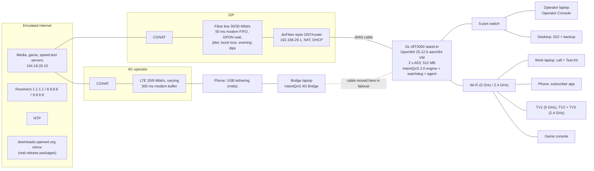

# Full-system test in emulation: IntentQoS 2.0 on real OpenWrt firmware

Date: 23–24 Nov 2026. Harness: [`systemsim/`](../systemsim/README.md). Everything below was produced by the
real programs running against a real OpenWrt image. The hardware, the lines and the household were emulated.
Every number comes from the captures in [`evidence/`](evidence/). Charts are in [`charts/`](charts/) and screenshots in
[`screens/`](screens/).

## What ran

* **Router:** the official **OpenWrt 25.12.6** image (kernel 6.12.112) in a QEMU aarch64 VM sized like a
  GL-MT3000. It had no battery clock, so it booted with the wrong date until NTP set it.
* **IntentQoS install:** the real **Router Setup** program, driven through its window, installed IntentQoS over
  SSH. The router downloaded **17 real OpenWrt packages** (8.1 MB) the way it would at home, including python3,
  tc-full and kmod-sched-cake. CoreMark and strace were added by hand only for the measurements below.
* **Kit programs:** the **Operator Console**, **Test Kit** and **4G Bridge** ran as the real Linux builds. A browser
  robot clicked through their windows the way a person would, and every step was screenshotted.
* **Household traffic:** eight devices ran at once, with their own MACs and DHCP identities: a Windows-style
  laptop and desktop, an Android phone with a private MAC, LG webOS TVs, a streaming stick and a PS5. Their
  one-way delays were measured as ground truth.
* **Recorded throughout:**
  * on the router: CPU per core, memory, `tc` statistics, syslog, and the engine's own event log;
  * from the engine: its API state every 2 s;
  * on the host: the VM's CPU use;
  * packet headers on the WAN, LAN and both radio ports (in the work directory, about 0.5 GB);
  * every Wi-Fi stall and scan (3,157 stalls and 664 scan dwells);
  * every link-rate change (255 on fibre, 3,753 on 4G);
  * every DNS query (9,026).

## Calibration: how close the emulated router is to a real MT7981

| | Emulated router (VM) | Real MT7981 |
|---|---|---|
| CoreMark per core | 6,205 | about 4,100 (scaled from a Raspberry Pi 3's 3,800 at 1.2 GHz) |
| Shaping with CAKE | **24 Mbit/s** on a 30 Mbit/s line at 91 % CPU; 34 on 50; 43 on 100 | about 200 Mbit/s reported |

The VM computes about 1.5x faster than the real chip, but forwards packets several times slower. So the line was
set to a **30/30 Mbit/s plan** (India's entry fibre tier). Even at 30 Mbit/s the emulated router ran **above 90 %
CPU for about 9 minutes** of the hour of tests. Tail-latency numbers under heavy load (p95/p99) are therefore
**pessimistic about the router**: they show what an overloaded router does, not what a GL-MT3000 would do.
Medians, behaviour and logic carry over. See [charts/calibration.png](charts/calibration.png).

## What the system test found and fixed (all on the real firmware)

Each of these was found only because the real image, real packages and real programs were in the loop. Each one
was fixed in the code, covered by a test (the suite went from 110 to **119 tests**, all passing), shipped to the
router through Router Setup, and checked again.

| # | Found in | What happened | Fix |
|---|---|---|---|
| 1 | First install | The engine **crash-looped on the real router**: `import uuid`. OpenWrt ships `uuid` in `python3-uuid`, which is not installed | removed the dependency; test `tests/test_router_stdlib.py` checks every engine import against what OpenWrt's packages provide |
| 2 | Idle router | The engine used **69 % of a core at idle** and the router was 88 % busy. It ran `tc -j -s qdisc show` per device per tick (about 7 processes a second), and OpenWrt's `tc` writes its JSON one byte per syscall | the CAKE counters are now read in-process over netlink (`RTM_GETQDISC`), checked identical to `tc`. Idle router CPU **88.5 % → 12.5 %**, engine 69 % → 16.5 % of a core |
| 3 | Test Kit run | One late reply from the busy router (`POST /api/bypass`, 10 s timeout) **aborted the whole test run** after its first test | the Test Kit retries the test-window request (4 tries with backoff) |
| 4 | Test Kit window | A **worse** "IntentQoS on" result was still shown in green | colour by whether the result actually improved |
| 5 | Failover | After the cable moved to 4G the reflector probes went silent for about 40 s (the 4G modem's 300 ms buffer was full at the fibre rate). **Blind mode held the fibre rate**, which kept the buffer full | blind *and* loaded → back off every 2 s towards what got through (floor 30 %); a **WAN gateway change** resets the baselines and restarts at 30 % of the plan (logged: `WAN path changed (gateway 192.168.29.1 -> 10.42.0.1)`) |
| 6 | Failover | When the engine stalled under load, the **watchdog put back 85 % of the *fibre* plan** and deleted the flow-marking table, and **the engine never noticed** (no re-apply) | the watchdog's safe plan is capped at the last rates the engine applied; the engine re-applies its shaping and flow marks after a trip (`watchdog had stepped in … 14 flow marks re-applied`); trip timeout 3 s → 8 s |
| 7 | Power cut | After a reboot **every device's type and name was gone** (the DHCP hook file and leases live in tmpfs) until each device renewed its lease, which takes hours | identities are cached on flash (`/etc/intentqos/identity.json`, written at most every 10 min). Checked with a second power cut: all 7 devices kept their type, marked "remembered from before the router restarted" |
| 8 | Host restart | The Operator Console started before the laptop had its home address. Its certificate covered only 127.0.0.1, so **the router could not report for an hour** (`IP address mismatch`) | the console re-issues its certificate when a new address appears and the controller reloads it. Checked: address at 14:16:00, certificate re-issued at 14:16:05, router enrolled at 14:16:09 |

Problems in the emulator itself were found and fixed along the way: a reply source address, CGNAT passes,
documentation address ranges hit by dnsmasq rebind protection, and an `nsenter` permission. They are logged in the
timeline and are not product findings.

## Results

### Install through the kit (screens 10–14)

* **First attempt:** failed at `apk update` (an emulator DNS issue).
* **Second attempt:** installed, but the engine crash-looped (finding 1).
* **Third attempt onwards:** installed and paired, and the router reported to the console.

The router showed **56 MB free flash** after all installs (80 MB before). After the first good install, Router
Setup was used five more times as the upgrade path for the fixes below (three times through its window, twice on
the command line), all without problems.

### Test Kit: five tests, IntentQoS off vs on (work laptop on 5 GHz Wi-Fi)

| Test | Off: p50 / p99 (ms) | On: p50 / p99 (ms) |
|---|---|---|
| Work call while a backup uploads | 60.7 / 79.7 | **22.1 / 63.3** |
| Game while big downloads run | 67.4 / 79.9 | **32.2** / 98.8 (tail worse) |
| Everyone online at once | 77.6 / 165.8 | **31.3 / 109.3** |
| Responsiveness (RPM test) | 61.5 / 88.4 | 77.4 / 98.7 (worse) |
| Home network only (laptop ↔ console) | capacity 46.3 Mbit/s, RPM 424 (loaded 104) | – |

The median delay halved or better in the three loaded tests. The tails were mixed. See
[charts/testkit.png](charts/testkit.png).

### An evening at home: every device busy at once, ground truth (charts/household.png)

| Metric | IntentQoS off | IntentQoS on |
|---|---|---|
| Call audio, one-way delay p50, down | 58.6 ms | **21.0 ms** |
| Call audio, delay p95 / p99, down | 66.6 / 80.8 ms | 80.5 / 91.8 ms |
| Call audio loss, down | 1.0 % | **0.3 %** |
| Game, delay p50 / p99, down | 58.9 / 80.3 ms | **20.5** / 91.6 ms |
| Uplink (call, game): delay p99 | 55 ms | 55 ms |
| ISO download / cloud backup | 17.1 / 13.8 Mbit/s | 14.0 / 18.3 Mbit/s |
| TV 1 / TV 3 bitrate (no rebuffering in either) | 2.46 / 1.53 Mbit/s | 1.50 / 1.50 Mbit/s |
| Phone page load p95 | 953 ms | **682 ms** |

**Read this carefully.**

* **What improved:** IntentQoS cut the typical delay for the call and the game to about a third, cut call loss,
  and made web pages load faster.
* **What got worse:** the p95/p99 tails. During the "on" arm the emulated router sat at **99.9 % CPU** and the
  watchdog stepped in twice. One of those restores took 12 s, the engine's estimator stopped updating, and its
  samples went stale.
* **What it means:** the tails measure the emulator's CPU limit plus the watchdog interaction fixed in finding 6.
  They are not a clean measure of IntentQoS. It has to be measured on a real GL-MT3000.

### Fibre → 4G failover under load (Test Kit's guided test; charts/failover.png)

The cable move took 4 s in hand. The first reply over 4G came **2–4 s after the cable was plugged in**: the router
got 10.42.0.x from the bridge laptop, and the NATs and the 4G CGNAT worked.

| Run | After the move: p50 / p95 / p99 (ms) | loss |
|---|---|---|
| IntentQoS off | 232 / 467 / 830 | 4.0 % |
| On, engine as first installed | 219 / 404 / 743 | 6.2 % |
| On + blind back-off + path-change reset | 366 / 773 / 915 | 8.2 % |
| On + watchdog fixes | **163 / 409 / 453** | 4.9 % |
| On + watchdog timeout 8 s | 236 / 749 / 836 | 4.7 % |

The engine's event log shows the logic working on the real firmware:

* the path change is detected;
* the rates restart at 8.1/8.1 Mbit/s;
* bufferbloat cuts take the upload to 2.7–3.9 Mbit/s;
* after a watchdog trip the engine re-applies its shaping.

In every run, though, the router was saturated (load 5, 100 % CPU) and the engine stalled for 10–40 s at a time.
So the end-to-end benefit varies from run to run and **is not demonstrated here**. Failover latency is the first
thing to measure on real hardware. Two runs in which the cable did not actually move (WAN link flaps on fibre) are
kept separately and labelled.

### Disturbances

* **Operator laptop asleep for 2 minutes:** the router kept shaping (API answered 12/12 times, CAKE at
  27 Mbit/s). The agent logged "controller unreachable … buffering telemetry", and the console showed the router
  online again after it woke.
* **Power cut (hard reset):**
  * LAN and internet back after **63.7 s** (58.5 s on the second cut);
  * engine and shaping after **89.3 s** (82 s);
  * clock correct straight after NTP;
  * device identities back immediately after the fix (finding 7).
* **Laptop moved two rooms away mid-call** (+12 ms Wi-Fi delay, 2 % loss): the engine still graded the call
  "great". Its Wi-Fi/line locator needs TCP flows or the radio's `iw station dump`, and the emulated router has no
  radio. **Not shown here:** whether IntentQoS spots a weak Wi-Fi link during a UDP call. That needs real radios.

### Router health

| | Test Kit run | Household, failover and disturbances |
|---|---|---|
| CPU mean / p95 | 39 % / 92 % | 52 % / 99.9 % |
| Memory used (max) | 155 MB of 478 MB | 157 MB of 478 MB |

Memory was never the constraint; CPU was. Engine events over the runs:

* 53 watchdog trips: 45 before the watchdog fix, 8 after;
* 68 estimator events;
* 18 drift warnings (the classifier abstained more on this unfamiliar traffic mix);
* 13 "boost" offers. Only 1 was the real game console (the PS5). 12 named the work laptop or the phone, because
  the Test Kit's probes (10 small packets a second) and a 200 ms ping look like game traffic. Offers need a
  stricter test before they reach the app. See [charts/router_cpu.png](charts/router_cpu.png).

## Not covered

* GL.iNet's own firmware and services (the VM runs upstream OpenWrt).
* Radios: signal, rate adaptation, roaming and hostapd statistics.
* PPPoE, IPv6, hardware flow offload.
* The Windows builds (the same Go code ran as Linux builds).
* The second router (a Cudy WR3000-like 256 MB OpenWrt 24.10.8 VM): prepared, not run, to keep CPU for the main
  router.
* All results are from emulation. None of them is a measurement on a physical GL-MT3000.

## Evidence

| File | What it holds |
|---|---|
| `evidence/timeline.jsonl.gz` | 1 merged timeline: tests, installs, fixes, cable moves, window steps |
| `evidence/run1` … `run3` | router `sys`, `tc`, syslog and engine events; engine API snapshots; host CPU (gzip) |
| `evidence/run3/household`, `resilience` | per-flow raw records (one-way delay of every packet) |
| `evidence/testkit-reports` | the Test Kit's own reports (JSON and HTML), including all 7 failover runs |
| `evidence/emulators` | Wi-Fi stall/scan events and per-station stats, link-rate traces, DNS queries, package mirror log, DHCP, the bridge laptop's sharing calls |
| `screens/` | 85 screenshots of every window step (Router Setup attempts, phone app, Test Kit, 4G Bridge, Operator Console) |
| `summary.json` | every number in this report |
