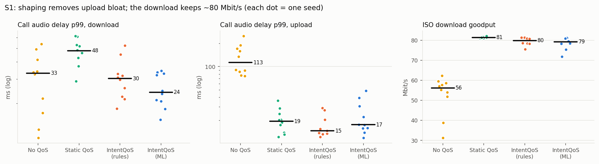
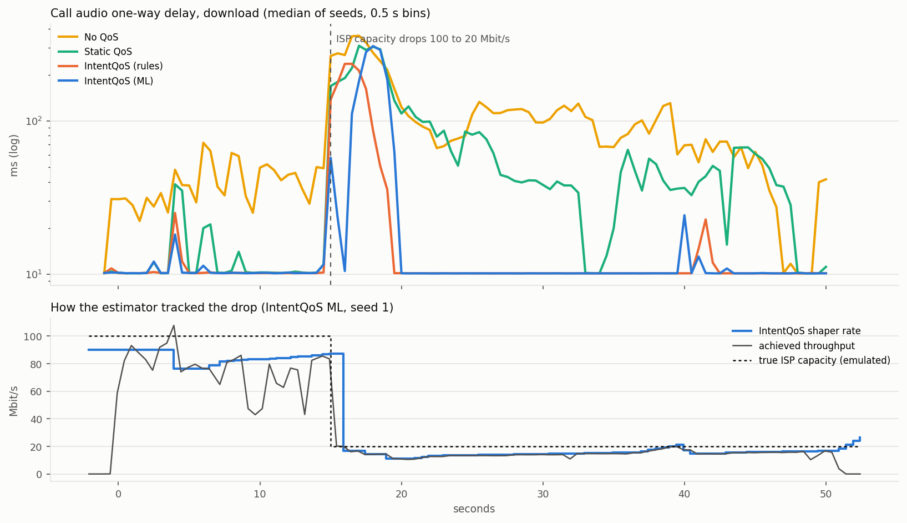
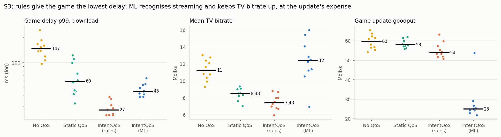
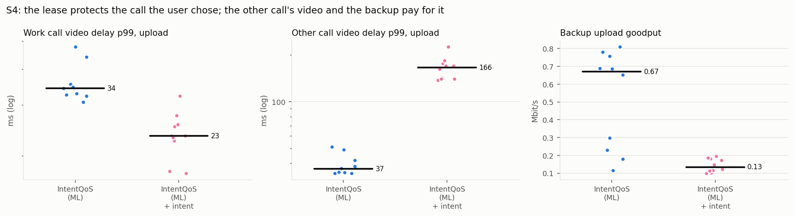
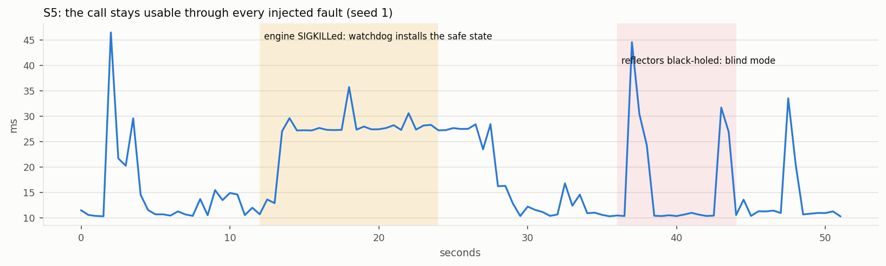

# IntentQoS evaluation report

Generated 2026-10-03 04:31 from `results/runs/`. Testbed: Linux 6.18.44-fc-v50, userspace-tun base delay, TCP cubic on hosts, ISP buffer 250 ms at nominal rate. **All network conditions are emulated** (network namespaces, `tbf` bottleneck); see `docs/KNOWN_LIMITATIONS.md`.

Each cell is the **median across seeds** with the interquartile range in brackets. The last column compares IntentQoS (ML) against every other arm: relative change of the median and the two-sided Mann-Whitney U p-value. Arms: *No QoS* (bloated ISP modem only), *Static QoS* (fixed shaper at 90 % of plan down / 95 % up, fixed shares, rule classifier), *IntentQoS (rules)*, *IntentQoS (ML)*, and in S3 *IntentQoS (ML), bulk-friendly* (the operator's bulk-friendly profile: bulk keeps 12 % and half of what is left; 10 seeds run later on the same testbed, see `results/environment-s3-bulk-friendly.json`).

## S1. A large ISO download (and a cloud backup) start during a video call

Runs per arm: IntentQoS (ML) 10, IntentQoS (rules) 10, Static QoS 10, No QoS 10

| Metric | IntentQoS (ML) | IntentQoS (rules) | Static QoS | No QoS | IntentQoS vs others |
|---|---|---|---|---|---|
| Call audio delay p99, download (ms) | 24.1 [20.9–32.7] | 30.3 [23.2–32.4] | 48.1 [43.7–52.8] | 33.1 [18.3–39.7] | better than IntentQoS (rules) by 20%, p=0.427; better than Static QoS by 50%, p<0.001; better than No QoS by 27%, p=0.521 |
| Call audio delay p99, upload (ms) | 17.5 [15.8–28.5] | 14.6 [13.4–19.1] | 19.4 [14.7–23.2] | 113 [86.9–169] | worse than IntentQoS (rules) by 20%, p=0.140; better than Static QoS by 10%, p=0.970; better than No QoS by 85%, p<0.001 |
| Call audio delay p99, first 6 s of the download (ms) | 48.3 [42.6–50.9] | 42.8 [42.1–44.3] | 57.0 [53.2–63.6] | 65.3 [64.4–68.3] | worse than IntentQoS (rules) by 13%, p=0.104; better than Static QoS by 15%, p=0.017; better than No QoS by 26%, p<0.001 |
| Call audio jitter (RFC 3550), download (ms) | 0.51 [0.28–0.68] | 0.27 [0.18–0.61] | 0.25 [0.21–0.31] | 0.15 [0.12–0.24] | worse than IntentQoS (rules) by 92%, p=0.212; worse than Static QoS by 102%, p=0.089; worse than No QoS by 231%, p=0.002 |
| Call quality (E-model MOS), download (MOS) | 4.36 [4.36–4.36] | 4.36 [4.36–4.36] | 4.36 [4.36–4.36] | 4.36 [4.36–4.36] | better than IntentQoS (rules) by 0%, p=0.385; better than Static QoS by 0%, p=0.005; better than No QoS by 0%, p=0.970 |
| Video delay p99, download (ms) | 23.9 [21.3–31.4] | 30.5 [24.6–33.0] | 47.9 [43.9–53.8] | 33.4 [19.0–44.1] | better than IntentQoS (rules) by 22%, p=0.241; better than Static QoS by 50%, p<0.001; better than No QoS by 28%, p=0.427 |
| Video delay p99, upload (ms) | 21.4 [20.8–29.2] | 19.2 [18.4–21.9] | 21.7 [16.9–25.7] | 113 [86.1–170] | worse than IntentQoS (rules) by 11%, p=0.186; better than Static QoS by 2%, p=0.473; better than No QoS by 81%, p<0.001 |
| Video packet loss, upload | 0.0% [0.0%–0.2%] | 0.0% [0.0%–0.1%] | 0.0% [0.0%–0.0%] | 0.0% [0.0%–0.0%] |  |
| ISO download goodput (Mbit/s) | 79.2 [78.3–81.0] | 79.9 [78.5–81.0] | 81.4 [81.3–81.5] | 56.2 [52.4–58.3] | worse than IntentQoS (rules) by 1%, p=0.734; worse than Static QoS by 3%, p=0.004; better than No QoS by 41%, p<0.001 |
| ISO download seconds with no progress (< 10 kbit/s) (s) | 0.00 [0.00–0.00] | 0.00 [0.00–0.00] | 0.00 [0.00–0.00] | 0.00 [0.00–0.00] |  |
| Cloud backup goodput (Mbit/s) | 14.0 [13.8–14.4] | 14.1 [13.7–14.3] | 13.9 [13.5–14.1] | 16.0 [15.9–16.1] | worse than IntentQoS (rules) by 1%, p=0.734; better than Static QoS by 0%, p=0.521; worse than No QoS by 13%, p<0.001 |
| Web page load p95 (ms) | 75.9 [73.9–79.3] | 142 [125–151] | 139 [128–203] | 135 [108–153] | better than IntentQoS (rules) by 47%, p<0.001; better than Static QoS by 45%, p<0.001; better than No QoS by 44%, p<0.001 |

## S2. WAN capacity drops from 100 to 20 Mbit/s (upload 20 to 5)

Runs per arm: IntentQoS (ML) 10, IntentQoS (rules) 10, Static QoS 10, No QoS 10

| Metric | IntentQoS (ML) | IntentQoS (rules) | Static QoS | No QoS | IntentQoS vs others |
|---|---|---|---|---|---|
| Call audio delay p99 after the drop, download (ms) | 340 [314–357] | 262 [216–397] | 442 [311–771] | 432 [318–728] | worse than IntentQoS (rules) by 30%, p=0.345; better than Static QoS by 23%, p=0.212; better than No QoS by 21%, p=0.162 |
| Call audio delay p99, 10 s after the drop onward (ms) | 46.7 [38.7–59.0] | 61.8 [53.5–67.0] | 92.7 [81.3–416] | 219 [156–551] | better than IntentQoS (rules) by 24%, p=0.076; better than Static QoS by 50%, p=0.003; better than No QoS by 79%, p<0.001 |
| Peak call delay in the 15 s after the drop (ms) | 364 [334–378] | 322 [239–429] | 450 [323–667] | 449 [330–649] | worse than IntentQoS (rules) by 13%, p=0.521; better than Static QoS by 19%, p=0.273; better than No QoS by 19%, p=0.212 |
| Time until call delay stays within 30 ms of baseline (s) | 4.9 [4.5–5.1] | 4.3 [3.5–6.2] | 15.4 [10.9–32.9] | 15.8 [6.3–18.8] | worse than IntentQoS (rules) by 13%, p=0.385; better than Static QoS by 68%, p<0.001; better than No QoS by 69%, p=0.009 |
| Call quality (MOS) after the drop (MOS) | 3.90 [3.86–3.92] | 3.97 [3.84–4.01] | 2.76 [1.69–3.46] | 2.24 [1.82–2.59] | worse than IntentQoS (rules) by 2%, p=0.345; better than Static QoS by 41%, p=0.003; better than No QoS by 74%, p<0.001 |
| Call audio delay p99 after the drop, upload (ms) | 325 [303–369] | 120 [112–153] | 401 [202–537] | 195 [112–517] | worse than IntentQoS (rules) by 171%, p=0.273; better than Static QoS by 19%, p=0.307; worse than No QoS by 66%, p=0.910 |
| Bulk download goodput after the drop (Mbit/s) | 3.9 [3.8–4.4] | 9.4 [8.4–9.6] | 13.4 [10.3–13.7] | 12.4 [11.6–13.4] | worse than IntentQoS (rules) by 58%, p<0.001; worse than Static QoS by 71%, p<0.001; worse than No QoS by 68%, p<0.001 |
| TV rebuffering (s) | 3.1 [0.68–3.9] | 17.7 [8.9–19.1] | 12.8 [11.3–14.3] | 11.4 [10.2–16.3] | better than IntentQoS (rules) by 82%, p=0.001; better than Static QoS by 76%, p=0.002; better than No QoS by 73%, p=0.006 |

## S3. Three TVs stream while a console games and a game update downloads

Runs per arm: IntentQoS (ML) 10, IntentQoS (ML), bulk-friendly 10, IntentQoS (rules) 10, Static QoS 10, No QoS 10

| Metric | IntentQoS (ML) | IntentQoS (ML), bulk-friendly | IntentQoS (rules) | Static QoS | No QoS | IntentQoS vs others |
|---|---|---|---|---|---|---|
| Game delay p99, download (ms) | 45.4 [41.8–53.0] | 40.5 [37.7–43.9] | 27.0 [23.7–30.2] | 59.8 [45.6–93.1] | 147 [124–166] | worse than IntentQoS (ML), bulk-friendly by 12%, p=0.045; worse than IntentQoS (rules) by 68%, p<0.001; better than Static QoS by 24%, p=0.104; better than No QoS by 69%, p<0.001 |
| Game delay p99, upload (ms) | 11.8 [11.5–12.2] | 18.8 [16.5–20.3] | 13.0 [12.6–14.6] | 14.8 [13.9–16.3] | 11.8 [11.6–11.9] | better than IntentQoS (ML), bulk-friendly by 37%, p<0.001; better than IntentQoS (rules) by 9%, p=0.004; better than Static QoS by 20%, p<0.001; better than No QoS by 0%, p=0.970 |
| Game jitter, download (ms) | 0.75 [0.29–1.9] | 0.81 [0.27–1.0] | 1.1 [0.40–1.8] | 0.95 [0.72–1.3] | 4.4 [3.4–5.4] | better than IntentQoS (ML), bulk-friendly by 7%, p=0.910; better than IntentQoS (rules) by 33%, p=0.623; better than Static QoS by 22%, p=0.734; better than No QoS by 83%, p<0.001 |
| Mean TV video bitrate (Mbit/s) | 12.4 [11.3–13.8] | 10.4 [10.3–11.3] | 7.4 [6.9–8.0] | 8.5 [8.3–8.9] | 11.3 [10.5–12.3] | better than IntentQoS (ML), bulk-friendly by 19%, p=0.031; better than IntentQoS (rules) by 67%, p=0.001; better than Static QoS by 46%, p=0.003; better than No QoS by 10%, p=0.212 |
| TV rebuffering, all three TVs (s) | 0.00 [0.00–3.8] | 0.00 [0.00–1.7] | 5.8 [0.42–12.8] | 0.00 [0.00–3.9] | 0.00 [0.00–0.00] | better than IntentQoS (rules) by 100%, p=0.076 |
| Fairness across TVs (Jain, bitrate) | 0.98 [0.89–1.00] | 0.99 [0.96–1.00] | 0.98 [0.98–0.99] | 0.97 [0.96–0.99] | 0.92 [0.90–0.97] | worse than IntentQoS (ML), bulk-friendly by 0%, p=0.791; better than IntentQoS (rules) by 0%, p=0.970; better than Static QoS by 1%, p=0.910; better than No QoS by 7%, p=0.521 |
| Game-update download goodput (Mbit/s) | 24.9 [24.3–26.4] | 37.6 [36.5–38.9] | 53.9 [52.3–56.9] | 58.0 [57.3–59.8] | 59.6 [56.6–62.1] | worse than IntentQoS (ML), bulk-friendly by 34%, p=0.003; worse than IntentQoS (rules) by 54%, p<0.001; worse than Static QoS by 57%, p<0.001; worse than No QoS by 58%, p<0.001 |
| Game-update seconds with no progress (< 10 kbit/s) (s) | 0.00 [0.00–0.00] | 0.00 [0.00–0.00] | 0.00 [0.00–0.00] | 0.00 [0.00–0.00] | 0.00 [0.00–0.00] |  |

## S4. Two video calls share a 10/3 Mbit/s link; the user prioritises the work call

Runs per arm: IntentQoS (ML) 10, IntentQoS (ML) + intent 10

| Metric | IntentQoS (ML) | IntentQoS (ML) + intent | IntentQoS vs others |
|---|---|---|---|
| Work call (laptop) video delay p99, upload (ms) | 34.3 [32.7–35.3] | 23.4 [22.7–25.5] | better than IntentQoS (ML) by 32%, p<0.001 |
| Work call (laptop) audio delay p99, upload (ms) | 12.7 [11.2–15.4] | 32.9 [27.2–96.5] | worse than IntentQoS (ML) by 158%, p=0.001 |
| Work call (laptop) MOS, upload (MOS) | 4.36 [4.36–4.36] | 4.36 [4.29–4.36] | worse than IntentQoS (ML) by 0%, p=0.054 |
| Work call (laptop) video loss, upload | 13.6% [8.7%–43.1%] | 0.0% [0.0%–0.2%] | better than IntentQoS (ML) by 100%, p<0.001 |
| Other call (phone) video delay p99, upload (ms) | 36.9 [34.9–40.9] | 166 [141–175] | worse than IntentQoS (ML) by 350%, p<0.001 |
| Other call (phone) MOS, upload (MOS) | 4.36 [4.36–4.36] | 4.36 [4.29–4.36] | worse than IntentQoS (ML) by 0%, p<0.001 |
| Bulk download goodput (Mbit/s) | 3.7 [3.6–3.8] | 3.7 [3.6–3.8] | worse than IntentQoS (ML) by 0%, p=0.945 |
| Backup upload goodput (Mbit/s) | 0.67 [0.25–0.74] | 0.13 [0.11–0.18] | worse than IntentQoS (ML) by 80%, p=0.003 |
| Backup worst 1-second goodput (Mbit/s) | 0.42 [0.12–0.57] | 0.00 [0.00–0.01] | worse than IntentQoS (ML) by 100%, p=0.006 |
| Backup seconds with no progress (< 10 kbit/s) (s) | 0.00 [0.00–0.00] | 1.0 [0.00–2.5] |  |

## S5. Fault injection: engine SIGKILL, restart, delay reflectors black-holed

Runs per arm: IntentQoS (ML) 10

| Metric | IntentQoS (ML) |
|---|---|
| Engine killed -> safe state installed (s) | 1.8 [1.8–1.8] |
| Call delay p99, engine running (ms) | 12.2 [11.8–12.4] |
| Call delay p99, engine dead (watchdog safe state) (ms) | 28.6 [28.1–39.9] |
| Call delay p99, after restart (ms) | 27.7 [19.8–30.2] |
| Call delay p99, delay reflectors black-holed (ms) | 20.2 [14.0–26.2] |
| Download seconds with no progress while the engine was dead (s) | 0.00 [0.00–0.00] |

